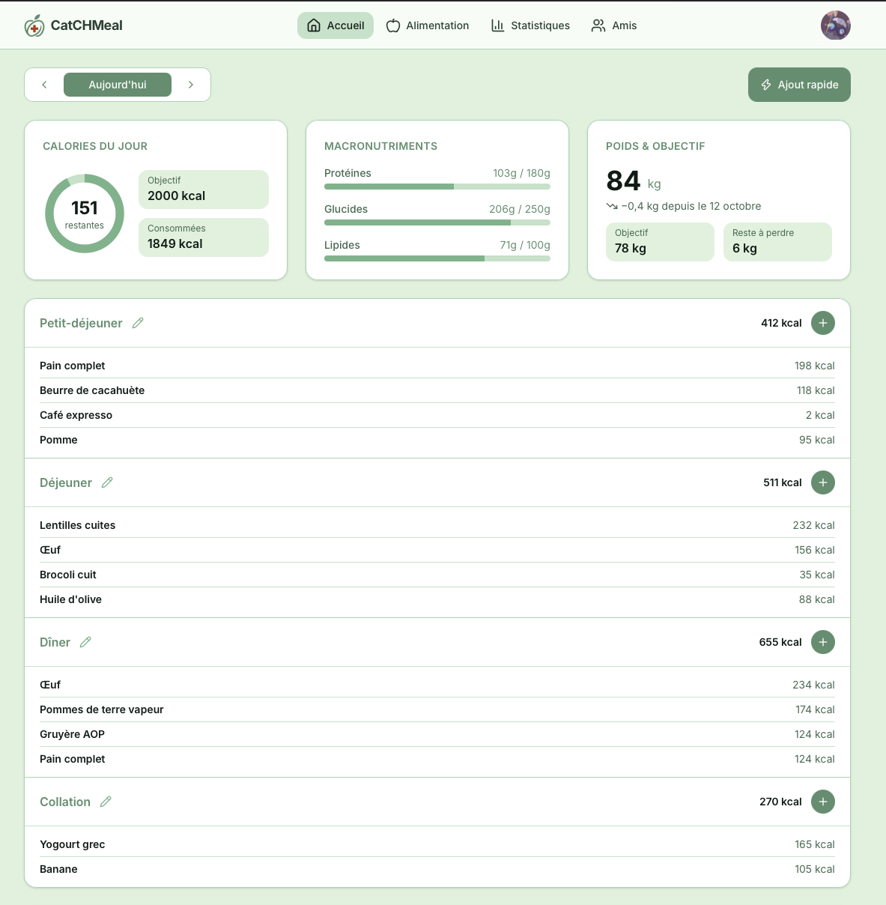
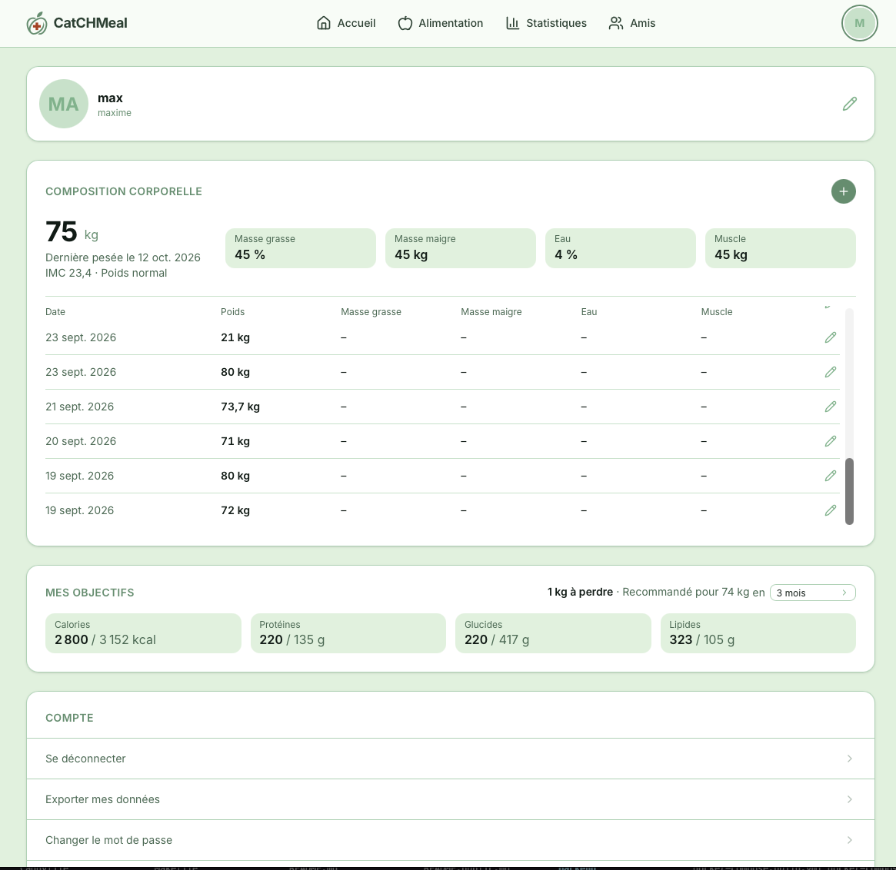
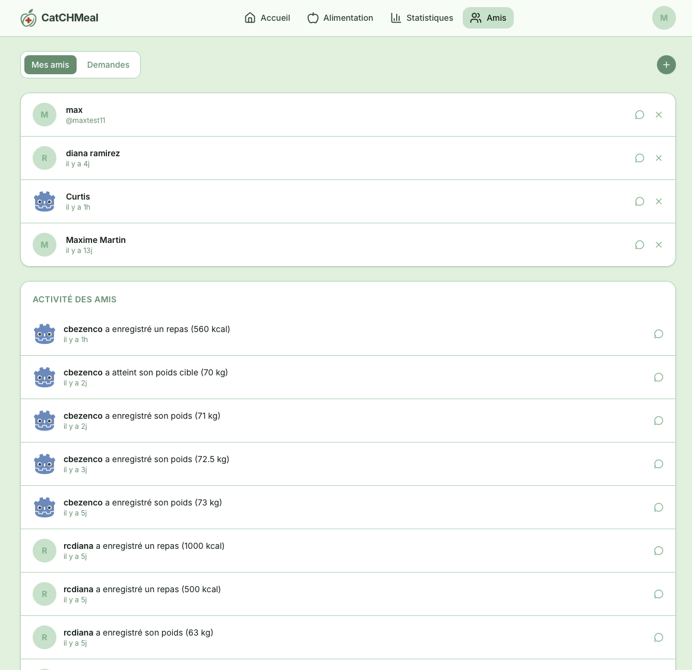
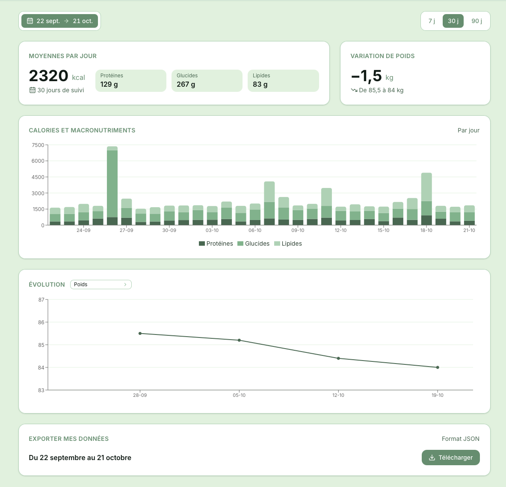
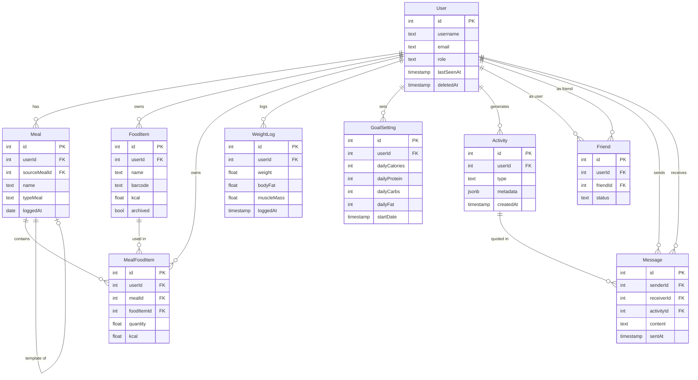

# CatCHMeal

[](./LICENSE)


A full-stack nutrition and wellness tracking web application. Users can log meals, track body composition, set calorie and macro goals, monitor progress through statistics, chat with friends, and get AI-powered dietary guidance.

## Table of Contents

- [Description](#description)
- [Screenshots](#screenshots)
- [Team](#team)
- [Technical Stack](#technical-stack)
- [Database Schema](#database-schema)
- [Features](#features)
- [Instructions](#instructions)
- [API Documentation](#api-documentation)
- [Resources](#resources)

## Description

CatCHMeal is a full-stack nutrition and wellness tracking web application. The application is centered around a personal health dashboard where users log meals, track their body composition over time, and receive AI-powered dietary guidance tailored to their goals.

The project combines a React frontend with client-side routing, a NestJS backend, a PostgreSQL database hosted on Supabase, WebSocket communication, HTTPS deployment through Nginx and Caddy, user accounts, OAuth login, barcode scanning via Open Food Facts, calorie and macro goal setting with BMR/TDEE recommendations, body composition history, real-time chat, friend system with presence tracking, activity feed, statistics and charts, GDPR data export, and an integrated Mistral AI assistant.

### Key Features

- User registration, login, logout, and OAuth authentication (42, Google, GitHub).
- Editable user profile with avatar upload, height, weight, gender, birth date, and activity level.
- Body composition tracking per weigh-in: body fat, muscle mass, fat-free mass, and body water.
- Calorie and macro goal setting with BMR/TDEE recommendations (Mifflin-St Jeor and Katch-McArdle).
- Food item CRUD with barcode scanning and Open Food Facts auto-fill.
- Meal logging with food items, quantities, macro scaling, and meal templates.
- Daily journal to view and manage meals logged on a specific day.
- Statistics and charts for calories, macros, and body composition over a selected period.
- Friend system with real-time presence, activity feed, and WebSocket-based chat.
- Mistral AI assistant with access to the user's meals, goals, and weight history.
- Admin board for user management (view, edit role, delete).
- GDPR-compliant data export (JSON), account deletion with anonymization, and legal pages.
- Accessibility: ARIA roles, labels, focus management, and keyboard navigation.

## Screenshots

The home dashboard is your daily hub — log meals, monitor your calorie and macro progress, and stay connected with your friends' activity.

<p align="center">
  
  <br/><em>Macro rings update in real time as you add food items to your meals.</em>
</p>

The profile page centralizes everything about you — your personal details, your body composition history, and your nutrition goals.

<p align="center">
  
  <br/><em>BMR and TDEE are computed automatically from your stats to suggest a daily calorie target.</em>
</p>

The friends page keeps you connected — see who's online, browse their recent meals and weigh-ins, and chat in real time.

<p align="center">
  
  <br/><em>Each activity card can be quoted directly in a chat message.</em>
</p>

The statistics page turns your logs into insights — visualize trends across any time period you choose.

<p align="center">
  
  <br/><em>Charts cover calories, protein, carbs, fat, and body composition metrics.</em>
</p>

## Team

[Natalino Munari](https://github.com/natamun), [Curtis Bezençon](https://github.com/CurtXY), [Diana Ramirez](https://www.linkedin.com/in/dianaramirezcarrillo), [Seully Trieste](https://www.linkedin.com/in/seully-trieste-dev/), [Maxime Martin](https://www.linkedin.com/in/maxime-martin-090731aa)

## Technical Stack

### Frontend
- **React 19** with TypeScript — component-based UI
- **Vite 8** — fast dev server and build tool
- **Tailwind CSS v4** — utility-first styling
- **React Router v8** — client-side routing
- **Recharts** — nutrition and body composition charts
- **Socket.IO client** — real-time chat and presence
- **zxing-wasm** — in-browser barcode scanning

### Backend
- **NestJS 11** with TypeScript — modular, decorator-based REST API
- **Passport.js** — JWT authentication + OAuth strategies (42, Google, GitHub)
- **Socket.IO** — WebSocket gateway for real-time messaging and presence
- **Multer** — file upload handling for avatars
- **Nodemailer + Mailtrap** — transactional emails
- **Mistral AI** — AI assistant via agent API
- **@nestjs/throttler** — rate limiting

### Database
- **PostgreSQL** (hosted on Supabase) — relational model fitting the structured relationships between users, meals, food items, goals, and weight logs. Supabase provides a managed instance with built-in Storage for avatar files.
- **Prisma 7** — type-safe ORM with migration management

### Infrastructure
- **Docker + Docker Compose** — containerized dev and prod environments
- **Nginx** — static file serving and reverse proxy in production
- **Caddy** — TLS termination in production
- **GitHub Actions** — CI/CD pipeline

## Database Schema



`FoodItem` is the cornerstone of the entire data model. It stores the nutritional values (kcal, protein, carbs, fat) for a given base quantity and unit (gram, milliliter, or piece). Every logged meal entry (`MealFoodItem`) references a `FoodItem` and records the actual quantity consumed — macros are then scaled proportionally at query time. Without a `FoodItem`, nothing can be logged. A `FoodItem` belongs to a user and can be created manually, filled from a barcode scan via Open Food Facts, or archived when no longer needed. This design keeps nutritional data centralized and reusable across multiple meals and days.

## Features

| Feature | Description |
|---|---|
| JWT Authentication | Register, login, logout with cookie-based JWT sessions |
| OAuth Login | Sign in with 42, Google, or GitHub |
| User profile | Edit name, username, height, weight, gender, birth date, activity level, goals |
| Avatar upload/delete | Upload and remove profile picture stored on Supabase Storage |
| Body composition tracking | Log and track body fat, muscle mass, fat-free mass, body water per weigh-in |
| Weight history | Full immutable weigh-in history with edit and delete |
| Calorie & macro goals | Set daily calorie, protein, carbs, fat targets with BMR/TDEE recommendations |
| Food item CRUD | Create, edit, archive, and search personal food items |
| Barcode scanner | Scan a barcode with the camera to look up a product on Open Food Facts |
| Open Food Facts integration | Auto-fill food form from barcode lookup |
| Meal logging | Log meals with food items, quantities, and macro scaling |
| Meal templates | Reuse a previous meal as a template |
| Daily journal | View and manage meals logged on a specific day |
| Statistics & charts | Calorie, macro, and body composition charts over a selected period |
| Data export | Export nutrition data as JSON for a selected period |
| Friend system | Send, accept, and decline friend requests |
| Real-time presence | See which friends are online and their last seen time |
| Friend activity feed | See friends' recent meals, weight logs, and goal changes |
| Real-time chat | WebSocket-based chat with friends, with activity quoting |
| AI assistant | Mistral-powered chatbot with access to user data (meals, goals, weight, analytics) |
| Admin board | Admin-only user management panel (view, edit role, delete users) |
| GDPR | Data export (JSON), account deletion with anonymization, legal pages |
| Accessibility | ARIA roles, labels, focus management, keyboard navigation |

## Instructions

### Prerequisites

- Docker and Docker Compose
- Make
- A Supabase project (for the database and avatar storage)
- A Mailtrap account (for transactional emails in dev)
- OAuth app credentials for Google and/or GitHub (optional)
- A Mistral API key and agent ID (for the AI assistant)

### Environment setup

1. Copy the root `.env.example` to `.env` and fill in the values:

```bash
cp .env.example .env
```

2. Copy the backend `.env.example` to `backend/.env` and fill in all values:

```bash
cp backend/.env.example backend/.env
```

Key variables to set in `backend/.env`:

| Variable | Description |
|---|---|
| `DATABASE_URL` | PostgreSQL connection string from Supabase |
| `JWT_SECRET` | Random secret string for signing JWT tokens |
| `SUPABASE_URL` | Your Supabase project URL |
| `SUPABASE_SERVICE_ROLE_KEY` | Supabase service role key (for Storage) |
| `MAILTRAP_HOST/PORT/USER/PASS` | Mailtrap SMTP credentials |
| `GOOGLE_CLIENT_ID/SECRET` | Google OAuth app credentials (optional) |
| `GITHUB_CLIENT_ID/SECRET` | GitHub OAuth app credentials (optional) |
| `MISTRAL_API_KEY` | Mistral API key |
| `MISTRAL_AGENT_ID` | Mistral agent ID |

3. Copy the frontend `.env.example` to `frontend/.env`:

```bash
cp frontend/.env.example frontend/.env
```

Key variables to set in `frontend/.env`:

| Variable | Description |
|---|---|
| `VITE_API_URL` | Backend API base URL (e.g. `http://localhost:3000`) |
| `VITE_SOCKET_URL` | WebSocket server URL (e.g. `http://localhost:3000`) |

### Running in development

```bash
make dev
```

This starts the frontend (http://localhost:5173) and backend (http://localhost:3000) with hot reload.

### API Documentation

The backend exposes a Swagger UI in development mode. Once `make dev` is running, open:

```
http://localhost:3000/api/docs
```

It lists every REST endpoint with its parameters, request body, and response schema. To test authenticated routes, log in through the app first — the JWT cookie is automatically sent by the browser.

> Swagger is disabled in production.

### Running database migrations

```bash
make migrate name=<migration_name>
```

### Useful commands

```bash
make logs-backend     # Stream backend logs
make logs-frontend    # Stream frontend logs
make shell-backend    # Open a shell in the backend container
make prisma-studio    # Open Prisma Studio at http://localhost:5555
make test             # Run backend unit tests
make check            # Run format check, lint, build, and all tests
make clean            # Stop all containers
make fclean           # Stop containers and remove images and volumes
```

### Running in production

```bash
make prod
```

Requires additional environment variables: `VITE_API_URL`, `FRONTEND_URL`, `POSTGRES_USER`, `POSTGRES_PASSWORD`, `POSTGRES_DB`.

## Resources

- [NestJS Documentation](https://docs.nestjs.com)
- [Prisma Documentation](https://www.prisma.io/docs)
- [React Documentation](https://react.dev)
- [Tailwind CSS v4 Documentation](https://tailwindcss.com/docs)
- [Socket.IO Documentation](https://socket.io/docs)
- [Supabase Documentation](https://supabase.com/docs)
- [Passport.js Documentation](https://www.passportjs.org/docs)
- [Open Food Facts API](https://openfoodfacts.github.io/openfoodfacts-server/api)
- [Mistral AI Documentation](https://docs.mistral.ai)
- [Recharts Documentation](https://recharts.org/en-US)

> Food product data is sourced from [Open Food Facts](https://world.openfoodfacts.org), a free, open and collaborative database licensed under the [Open Database License (ODbL)](https://opendatacommons.org/licenses/odbl/1-0/).
